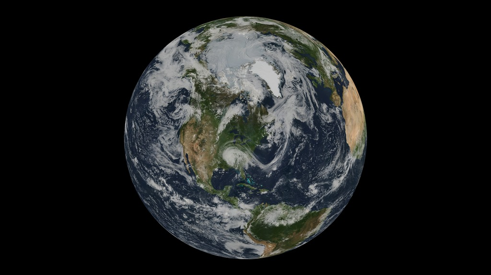
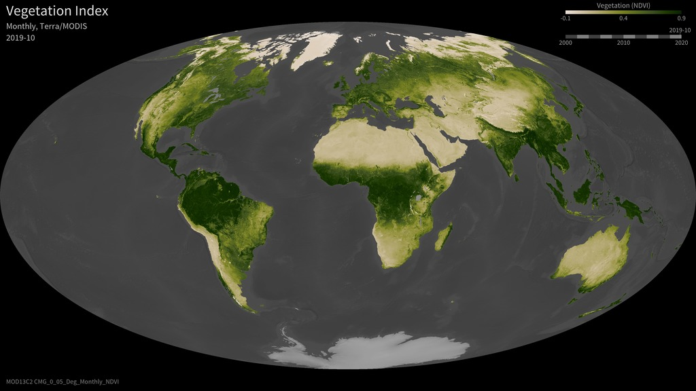
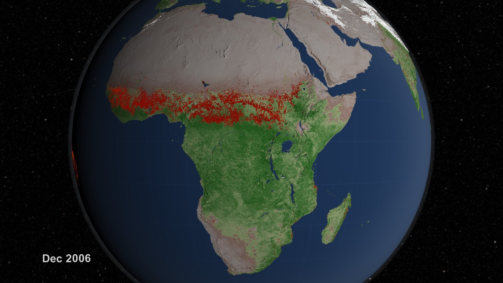
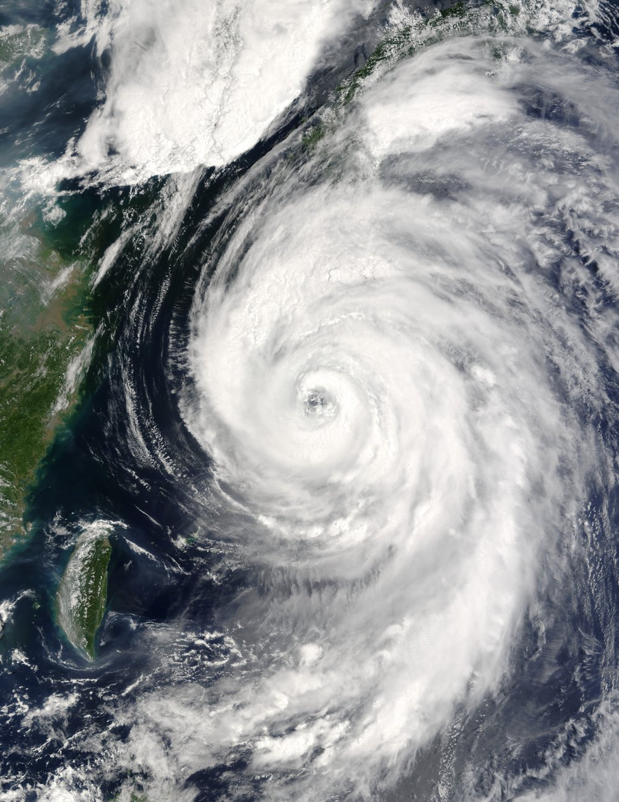
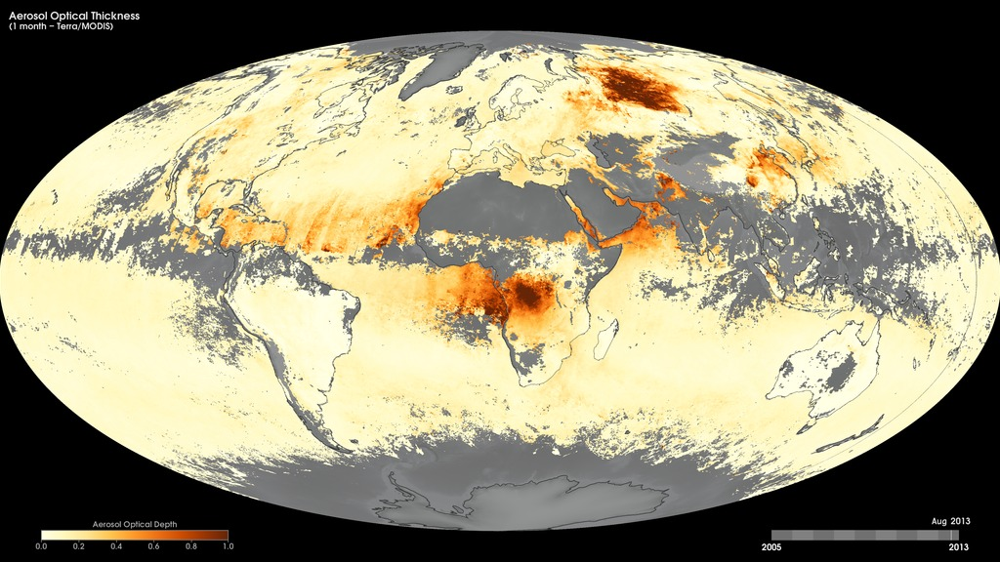

# MODIS Terra — Танилцуулга

Nov 15, 2026 · @tugu

## Товч танилцуулга

MODIS (Moderate Resolution Imaging Spectroradiometer — Дунд нарийвчлалын дүрслэх спектрорадиометр) бол дэлхийг бүхэлд нь 1–2 хоногт нэг удаа зурагладаг, 36 спектрийн сувагтай мэдрэгч төхөөрөмж юм. Анхны MODIS-ийг NASA-гийн Terra хиймэл дагуулд суулгаж, 1999 оны 12-р сарын 18-нд хөөргөсөн.

- **Terra** (хуучин нэр нь EOS AM-1) нь NASA-гийн Дэлхийг ажиглах системийн (EOS) тэргүүлэх хиймэл дагуул бөгөөд 5 багаж тээдэг: MODIS, ASTER, MISR, CERES, MOPITT.
- Хоёр дахь MODIS нь **Aqua** хиймэл дагуулд байрласан (2002 онд хөөргөсөн). Terra өглөө, Aqua үдээс хойш экваторыг гаталдаг тул хоёулаа хамтдаа өдөрт дэлхийг 4 удаа ажигладаг.
- Terra нь 6 жил ажиллахаар зохион бүтээгдсэн боловч 25 гаруй жил ажилласан.

## Хэн бүтээсэн, хэзээ

MODIS-ийг **Raytheon Santa Barbara Remote Sensing (SBRS)** компани (Калифорни, АНУ) загварчилж, бүтээж, туршсан. Төслийг **NASA-гийн Goddard сараар нислэгийн төв** (Мэриланд) удирдан захиалсан. SBRS нь өмнө нь Hughes компанийн хэсэг байгаад дараа нь Raytheon-д шилжсэн. Өндөр чадвартай түлшинг Terra хөөргөх Atlas-Centaur IIAS пуужин хөөргөсөн.

| Он | Үйл явдал |
|---|---|
| 1989 | MODIS-ийн анхны санаа (MODIS-N, 40 сувагтайгаар төлөвлөсөн) |
| 1990 | NASA Goddard техникийн шаардлагыг боловсруулж, SBRS-ийг гүйцэтгэгчээр сонгосон |
| 1995 | Инженерийн загвар (Engineering Model) бэлэн болсон |
| 1999 оны 12-р сарын 18 | Terra хиймэл дагуулыг Vandenberg баазаас хөөргөсөн |
| 2000 оны 2-р сарын 24 | MODIS-ийн анхны зураг («First Light») |
| 2002 оны 5-р сарын 4 | Хоёр дахь MODIS-ийг Aqua дээр хөөргөсөн |
| 2022 оны 10-р сар | Түлш дууссан тул Terra 705 км-ийн тойргирогоос доошилж «Өглөөний санвар»-аас гарсан |

Эх сурвалж: [NASA NTRS](https://ntrs.nasa.gov/citations/20120010130), [MODIS бүрэлдэхүүн](https://modis.gsfc.nasa.gov/about/components.php), [IEEE TGRS 1998](https://zenodo.org/record/1261767/files/article.pdf)

## Зорилго ба техникийн үзүүлэлт

MODIS-ийн гол зорилго нь хуурай газар, далай, агаар мандлын өөрчлөлтийг дэлхийн хэмжээнд өдөр бүр хэмжиж, урт хугацааны уур амьсгалын өөрчлөлтийг ойлгоход туслах байсан. Нэг багажаар агаар, хуурай газар, далайг зэрэг ажигладагаараа онцлогтой.

Юуг хэмждэг:

- **Агаар мандал:** үүлшилт, аэрозоль (тоос, утаа, шороо), усны уур, озон
- **Хуурай газар:** ургамал (NDVI), газрын бүрхүүл, гадаргын температур, цасны бүрхүүл, гал түймэр, шатсан талбай
- **Далай:** далайн гадаргын температур, хлорофилл (фитопланктон), далайн мөс

| Үзүүлэлт | Утга |
|---|---|
| Тойргирог | 705 км, нартай синхрон, туйлын ойролцоох; экваторыг өглөө 10:30-д гаталдаг |
| Спектрийн суваг | 36 суваг, 0.41–14.4 мкм (үзэгдэх гэрлээс дулааны инфраулаан хүртэл) |
| Орон зайн нарийвчлал | 250 м (2 суваг), 500 м (5 суваг), 1 км (29 суваг) |
| Харах зурвасын өргөн | 2,330 км |
| Дахин ажиглах давтамж | Дэлхийг бүхэлд нь 1–2 хоногт |
| Жин | 228.7 кг |
| Хэмжээ | 1.0 × 1.6 × 1.0 м |
| Цахилгаан сангийн хэрэглээ | 162.5 Вт (дундаж) |
| Өгөгдлийн урсгал | 10.6 Мбит/с (өдрийн дээд), 6.1 Мбит/с (дундаж) |
| Квантачлал | 12 бит |
| Төлөвлөсөн ашиглалтын хугацаа | 6 жил |

Эх сурвалж: [MODIS техникийн үзүүлэлт (NASA)](https://modis.gsfc.nasa.gov/about/specifications.php), [LAADS DAAC](https://ladsweb.modaps.eosdis.nasa.gov/missions-and-measurements/modis/)

## Гол амжилт, гавьяа

MODIS Terra-гийн хамгийн том гавьяа бол 6 жилийн төлөвлөсөн ашиглалтын оронд 25 гаруй жил тасралтгүй ажиглалт хийж, дэлхийн уур амьсгалын судалгааны суурь болсон урт цуврал өгөгдөл үлдээсэнд оршино. Terra 100,000 гаруй тойргирог хийсэн.

1. **Дэлхийн хэмжээнд гал түймрийг анх удаа дэлгэрэнгүй зурагласан.** Terra ба Aqua-гийн MODIS хоёр өдөрт 4 удаа гал илрүүлж, эхний 15 жилд 40 сая гаруй идэвхтэй түймэр бүртгэсэн. Энэ нь түймрийн уур амьсгал, нүүрстөрөгчийн цикл, агаарын чанарт үзүүлэх нөлөөг ойлгох аргыг өөрчилсөн.
2. **FIRMS түймрийн сэргийлэх систем.** MODIS-ийн бараг бодит хугацааны мэдээлэл дээр суурилсан энэ систем долоо хоног бүр ойролцоогоор 240,000 түймрийн сэргийлэг 160 гаруй орны хэрэглэгчид илгээдэг.
3. **Цаг агаарын таамаглалыг сайжруулсан.** Туйлын бүсийн үүлний хөдөлгөөнийг мөшдөж гаргасан «туйлын салхи» (polar winds) өгөгдлийг ECMWF зэрэг цаг агаарын төвүүд ажиллагаандаа ашигладаг болсон (дэлгэрэнгүйг доорх «Нарийвчлал» хэсгээс).
4. **Ургамал, газар ашиглалтын өөрчлөлт.** Ургамлын индекс (NDVI/EVI), ойн хэвлэг сайханы хувьсал, цөлжилт, цасны бүрхүүлийн чиг хандлагыг 20 гаруй жилээр тасралтгүй хэмжсэн. Монгол зэрэг орнуудад цас, бэлчээр, ган, хээрийн түймэр хянахад өргөн ашиглагддаг.
5. **Агаарын бохирдол ба агаарын чанар.** Аэрозолийн бүтээгдэхүүний өгөгдөл нь тоос шороо, утааны тархалтыг хянахад ашиглагддаг. Европын CAMS албаны түймрийн хаялалын 23 жилийн өгөгдлийн сан MODIS дээр суурилсан.
6. **Далай ба мөс.** Далайн гадаргын температур, фитопланктоны цэцэглэлт, Антарктидын мөсөн тавцан нурах (жишээ нь 2002 оны Larsen B) зэрэг үзэгдлийг бүртгэсэн.

Хэрэглээний цар хүрээ: уур амьсгалын загварчлал, цаг агаарын тоон таамаглал, байгалийн гамшиг, хөдөө аж ахуй, байгаль орчны менежмент.

Эх сурвалж: [NASA SVS — Арван жилийн түймэр](https://svs.gsfc.nasa.gov/10851), [NASA Earthdata — LANCE/FIRMS](https://earthdata.nasa.gov/news/feature-articles/lance-top-10-10), [AGU 2014 — MODIS-ийн 15 жил](https://agu.confex.com/agu/fm14/webprogram/Paper7554.html), [CAMS](https://atmosphere.copernicus.eu/drifting-away-modis-cams-global-fire-assimilation-system), [Design World / NASA — 15 жилд 15 гайхамшиг](https://www.designworldonline.com/earth-from-space-15-amazing-things-in-15-years/)

## Нарийвчлал ба таамаглах чадвар

MODIS өөрөө «таамагладаг» биш, хэмждэг багаж; түүний хэмжилтийг загварт оруулснаар таамаглал сайжирдаг. Газар дээрх хэмжилттэй харьцуулсан баталгаажуулалтаар гол бүтээгдэхүүний нарийвчлал дараах байдалтай байсан.

| Бүтээгдэхүүн | Харьцуулсан зүйл | Үр дүн |
|---|---|---|
| [Аэрозолийн оптик гүн (AOD), хуурай газар](https://acp.copernicus.org/articles/10/10399/2010/) | AERONET, 300+ цэг, 85,463 хос хэмжилт | Хэмжилтийн 66%-аас дээш нь ±(0.05 + 15%) алдааны хүрээнд; корреляци R = 0.9 |
| [AOD, далай дээр](https://amt.copernicus.org/articles/12/4291/2019/amt-12-4291-2019.pdf) | AERONET | Хүлээгдэх алдаа ±(0.03 + 5%) |
| [Далайн гадаргын температур (SST)](https://corpora.tika.apache.org/base/docs/govdocs1/383/383702.pdf) | Хөлөг онооцон дээрх M-AERI радиометр | Хазайлт −0.025 K, стандарт хазайлт 0.48 K |
| [Идэвхтэй гал илрүүлэлт (MOD14 C6)](https://www.bohrium.com/paper-details/the-collection-6-modis-active-fire-detection-algorithm-and-fire-products/814547052368232449-3747) | 2,500 гаруй ASTER өндөр нарийвчлалтай зураг | Өдрийн худал дохиоллын алдаа 1.2% (өмнөх хувилбарт 2.4%) |
| [Туйлын салхи → цаг агаарын таамаглал](https://earthobservatory.nasa.gov/Features/PolarWinds/polar_winds4.php) | ECMWF-ийн загвар, MODIS-тэй ба MODIS-гүй | 7–8 дахь өдрийн таамаглалын ашигтай хугацаа Европ, Хойд Атлантид ойролцоогоор 3 цагаар уртассан |

- **Гал илрүүлэх алгоритм** сайжирсаар байсан: 2003 оны шинэчлэл нь хоёр дахин жижиг түймрийг илрүүлж, худал дохиоллыг 10–100 дахин багасгасан ([Giglio et al., 2003](https://peeref.com/works/71490761)).
- **Таамаглалд ашигласан төвүүд:** ECMWF, NASA GMAO, Японы цаг уурын агентлаг, Канадын цаг уурын төв, АНУ-ын Тэнгисийн цаг уурын төв — 5 төв ажиллагаандаа ашигласан.
- **Сул тал:** ганцаардаа жижиг болон утаанд дарагдсан түймрийг алдах, хуурай газрын аэрозолийн хэмжилт гадаргуун тод газар алдаа ихсэх, 1 км-ийн нарийвчлал жижиг объектид хангалтгүй байх.

## Одоогийн байдал ба залгамжлагч

MODIS Terra ажилласан хэвээр байгаа боловч төгсгөлдөө ойртож байна: NASA цахилгааны хязгаарлалтын улмаас Terra MODIS-ийн шинжлэх ухааны өгөгдөл цуглуулалтыг **2027 оны 1-р сар орчим** зогсоохоор төлөвлөсөн.

- **Түлш дууссан:** 2020 оноос хойш тойргирог засах маневр хийхээ больсон. Иймээс экватор гатлах цаг алагсаж, өндөр аажмаар буурч байна.
- **2026 оны 1-р сар:** Цахилгаан хэмнэхийн тулд Terra-гийн өөр багаж болох ASTER-ийн дулааны инфраулаан сувгийг унтраасан.
- **2026 оны 3-р сарын 26:** Сарааны аномалиас болж MODIS түр бэлэн горимд орсон ч дараа өдөр нь хэвийн ажиллагаандаа буцсан.
- **2026 оны 3-р сар:** Хамгийн сүүлийн шинэчлэсэн калибрацитай MODIS Version 7.0 өгөгдөл гарсан.
- **Эцсийн дахин боловсруулалт:** Ажиглалт дуусмагц бүх өгөгдлийг v8.0 хувилбараар дахин боловсруулж, 2030 оны 1-р сар гэхэд дуусгах төлөвлөгөөтэй.

**Залгамжлагч — VIIRS.** Suomi NPP, NOAA-20, NOAA-21 хиймэл дагуул дээрх VIIRS багаж MODIS-ийн өгөгдлийн цувралыг үргэлжлүүлнэ. Харин VIIRS үдээс хойш гаталдаг тул Terra-гийн ажигладаг **өглөөний цагийн ажиглалтыг орлох NASA-гийн багаж одоогоор байхгүй**.

Эх сурвалж: [LAADS DAAC — MODIS-аас VIIRS рүү шилжих](https://ladsweb.modaps.eosdis.nasa.gov/learn/modis-to-viirs-transition), [NASA Earthdata — Terra MODIS standby](https://www.earthdata.nasa.gov/data/alerts-outages/terra-modis-placed-standby-mode), [NASA Earthdata — MODIS v7.0](https://www.earthdata.nasa.gov/data/alerts-outages/version-7.0-modis-calibrated-radiances-geolocation-data-products-now-0), [Spatial Source — ASTER TIR](https://www.spatialsource.com.au/?p=45383)

## MODIS Terra-тай холбоотой 5 зураг

Бүх зураг NASA-гийн Goddard-ын Scientific Visualization Studio (SVS)-аас авсан, нийтийн хэрэглээнд чөлөөтэй зураг бөгөөд ашиглахдаа «NASA/Goddard Space Flight Center» гэж дурдана.

### 1. «Хөх эрдэнэ» (Blue Marble), 2002

Тухайн үед Дэлхийн хамгийн нарийвчилсан жинхэнэ өнгөтэй зураг. Хуурай газар, далай, үүлшилтийн ихэнх мэдээллийг Terra MODIS-ийн 2001 оны ажиглалтаас нийлүүлсэн. [Эх сурвалж](https://svs.gsfc.nasa.gov/30614)

### 2. Дэлхийн ургамлын индекс (NDVI), 2019 оны 10-р сар

Хар ногоон нь ургамал ихтэй, шаргадууд нь ургамал багатай газрыг харуулна. 2000 оноос хойш сар бүр гардаг Terra MODIS-ийн бүтээгдэхүүн. [Эх сурвалж](https://svs.gsfc.nasa.gov/31053)

### 3. Африк дахь гал түймэр, 2006 оны 12-р сар

Улаан цэгүүд нь MODIS-ийн илрүүлсэн идэвхтэй түймэр, ногоон нь ургамлын индекс. Сахелийн өмнөдхи саваннад хуурай улиралд түймэр өргөн тарсаныг харуулна (Terra ба Aqua MODIS). [Эх сурвалж](https://svs.gsfc.nasa.gov/3868)

### 4. Тайфун Этау, 2003 оны 8-р сарын 7

Terra MODIS-ийн 250 м нарийвчлалтай зураг: тайфун Окинава арлын орчимд, зүүн доод талд Тайвань. Агаар мандлын аюулт үзэгдлийг хянах жишээ. [Эх сурвалж](https://svs.gsfc.nasa.gov/2792)

### 5. Аэрозолийн оптик зузаан, 2013 оны 8-р сар

Хүрэн улаан хэсэг нь агаарт тоос, утаа, шороо ихтэй газар (Сибирийн ойн түймэр, Төв Африк, Сахарын шороо). Саарал нь үүлтэй тул хэмжигдээгүй хэсэг. [Эх сурвалж](https://svs.gsfc.nasa.gov/30381)

## Эх сурвалж

- [NASA NTRS — Terra and Aqua MODIS Design, Radiometry, and Geometry](https://ntrs.nasa.gov/citations/20120010130)
- [MODIS Components (NASA)](https://modis.gsfc.nasa.gov/about/components.php)
- [MODIS Specifications (NASA)](https://modis.gsfc.nasa.gov/about/specifications.php)
- [Photonics.com — Raytheon MODIS](https://www.photonics.com/Article.aspx?AID=12704)
- [Levy et al. 2010 — MODIS аэрозолийн баталгаажуулалт (ACP)](https://acp.copernicus.org/articles/10/10399/2010/)
- [Jethva et al. 2019 (AMT)](https://amt.copernicus.org/articles/12/4291/2019/amt-12-4291-2019.pdf)
- [Minnett & Evans — MODIS SST баталгаажуулалт](https://corpora.tika.apache.org/base/docs/govdocs1/383/383702.pdf)
- [Giglio et al. 2016 — MODIS Collection 6 гал илрүүлэлт](https://www.bohrium.com/paper-details/the-collection-6-modis-active-fire-detection-algorithm-and-fire-products/814547052368232449-3747)
- [NASA Earth Observatory — Polar Winds](https://earthobservatory.nasa.gov/Features/PolarWinds/polar_winds4.php)
- [NASA Earthdata — LANCE Top 10 (FIRMS)](https://earthdata.nasa.gov/news/feature-articles/lance-top-10-10)
- [LAADS DAAC — MODIS to VIIRS Transition](https://ladsweb.modaps.eosdis.nasa.gov/learn/modis-to-viirs-transition)
- [NASA Earthdata — Transition from MODIS to VIIRS](https://www.earthdata.nasa.gov/data/alerts-outages/transition-from-modis-viirs)
- [CAMS — Drifting away from MODIS](https://atmosphere.copernicus.eu/drifting-away-modis-cams-global-fire-assimilation-system)
- [NASA SVS — зургийн сан](https://svs.gsfc.nasa.gov/)
